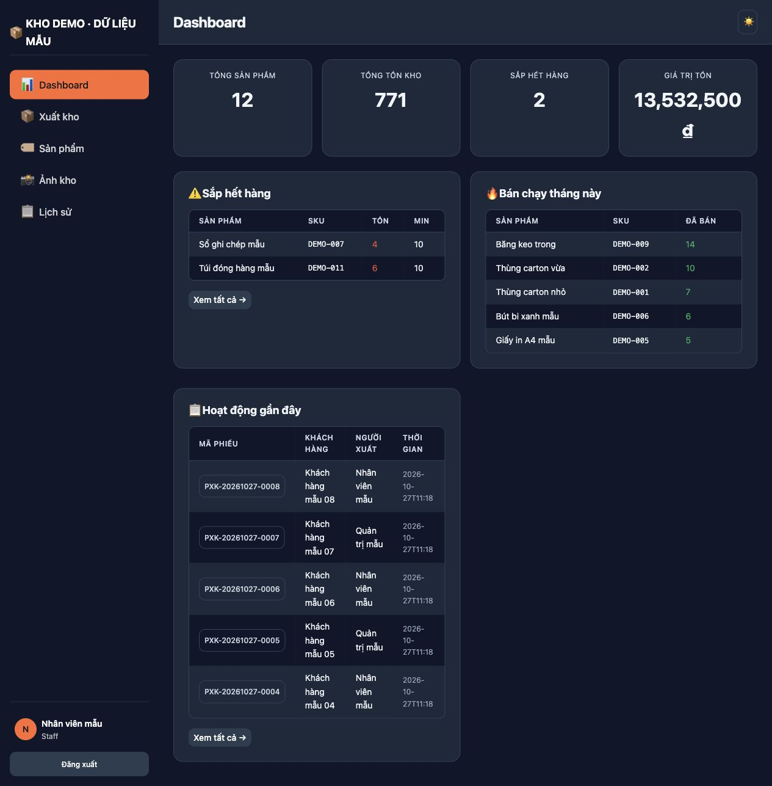
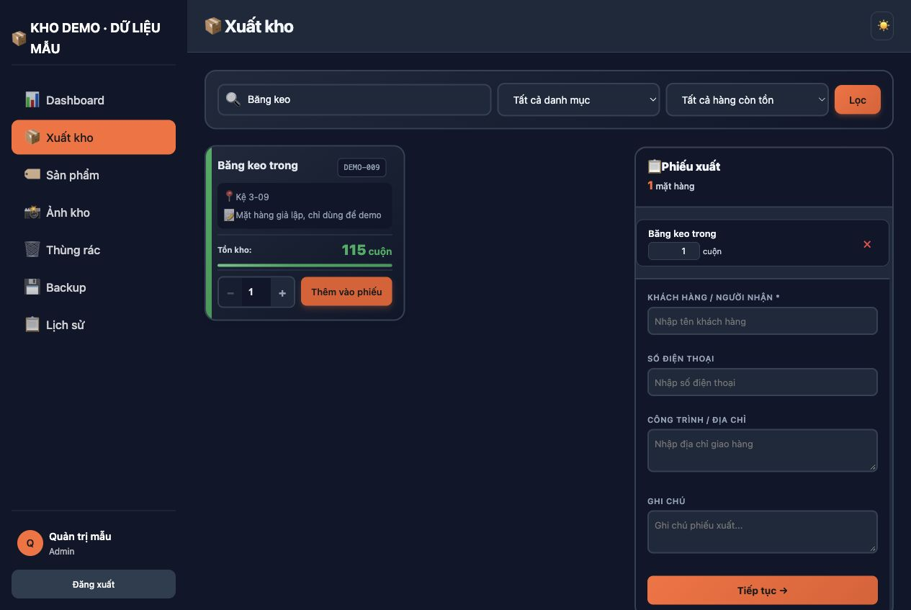
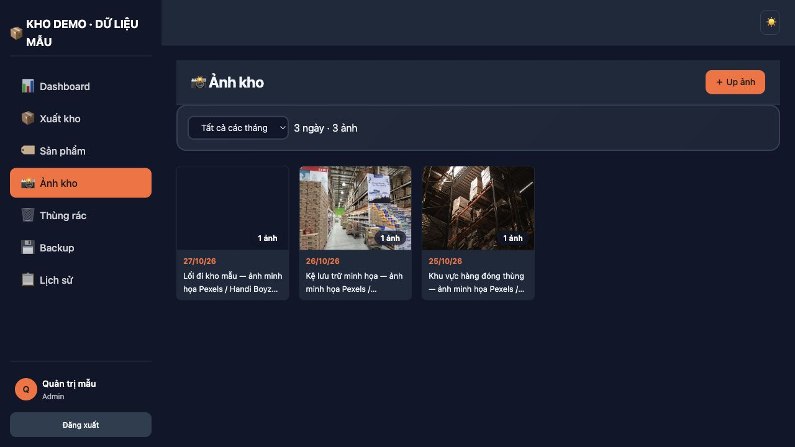
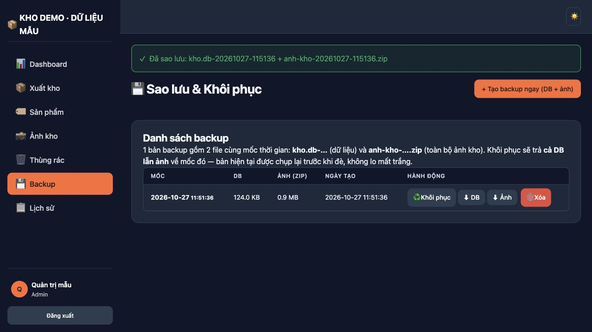

# 📦 Quản lý kho hàng

Ứng dụng web quản lý kho và xuất kho viết bằng **Flask + SQLite**, giao diện
tiếng Việt, chạy tốt trên desktop và điện thoại. Dữ liệu nằm gọn trong một file
SQLite; ảnh kho lưu trên đĩa và được phục vụ qua route có kiểm tra đăng nhập.



## Tính năng

- **Dashboard**: tổng sản phẩm, tổng tồn, giá trị tồn, hàng sắp hết, bán chạy
  trong tháng, phiếu gần đây.
- **Xuất kho**: tìm theo tên/SKU/ghi chú, chọn nhiều mặt hàng, giỏ phiếu,
  xem lại trước khi xác nhận; chống tạo trùng phiếu khi bấm hai lần.
- **Phiếu xuất**: chi tiết, in phiếu, lịch sử, huỷ phiếu (hoàn hàng về kho),
  đánh dấu đã xuất hoá đơn kèm lịch sử thay đổi.
- **Sản phẩm**: thêm/sửa/xoá mềm, thùng rác, khôi phục, tìm kiếm và lọc.
- **Ảnh kho**: upload nhiều ảnh (chọn file, kéo thả hoặc dán clipboard), nén
  JPEG + thumbnail, gallery 1 ngày = 1 card, xem theo ngày, sửa/xoá ảnh.
- **Backup**: một nút tạo cặp file DB + ZIP ảnh cùng mốc; khôi phục theo mốc;
  tự tạo bản `before-restore` trước khi ghi đè.
- **Link chỉ-đọc** `/xem/<token>` cho chủ kho xem ảnh mà không cần đăng nhập.
- **Bảo mật**: CSRF, session HttpOnly/SameSite, khoá tài khoản khi sai mật khẩu,
  rate limit, CSP, cookie Secure khi chạy HTTPS.
- **Dark mode**, responsive, không cần build frontend.

| Xuất kho | Ảnh kho | Backup |
| --- | --- | --- |
|  |  |  |

## Công nghệ

| Thành phần | Phiên bản |
| --- | --- |
| Python | 3.10+ (đã kiểm tra 3.11 và 3.13) |
| Flask / Werkzeug | 3.1.1 / 3.1.8 |
| SQLite | có sẵn trong Python |
| Waitress | 3.0.2 |
| Pillow | 11.3.0 (nén ảnh) |
| Giao diện | Jinja2 + CSS + JavaScript thuần |

## Cấu trúc

```
.
├── run_web.py                 # server phát triển
├── wsgi.py                    # entrypoint Waitress/Gunicorn
├── webapp/                    # ứng dụng Flask
│   ├── auth.py                # đăng nhập, session, rate limit
│   ├── inventory.py           # trang chọn hàng
│   ├── exports.py             # tạo/xem/huỷ phiếu
│   ├── products.py            # CRUD sản phẩm
│   ├── photos.py              # ảnh kho
│   ├── print.py               # phiếu in
│   ├── backup.py              # sao lưu/khôi phục
│   ├── share.py               # link chỉ đọc
│   ├── services/              # xử lý nghiệp vụ, nén ảnh
│   ├── templates/             # Jinja2
│   └── static/                # CSS, JS
├── migrations/                # migration SQL có đánh số
├── scripts/                   # tạo DB, migration, tài khoản, seed demo
├── docs/                      # kiến trúc, backup, triển khai, ảnh
├── demo/photos/               # ảnh Pexels cho dữ liệu mẫu
└── data/                      # kho.db + media + backups (không commit)
```

## Chạy nhanh với dữ liệu mẫu

Yêu cầu Python 3.10+.

```bash
git clone <URL_REPO> kho-hang
cd kho-hang

python3 -m venv .venv
source .venv/bin/activate            # Windows: .venv\Scripts\activate
pip install -r requirements.txt

cp .env.example .env
python -c "import secrets; print(secrets.token_urlsafe(48))"
# mở .env, dán chuỗi vừa tạo vào KHO_WEB_SECRET_KEY

python scripts/seed_demo.py
python run_web.py
```

Mở http://127.0.0.1:5000.

| Tài khoản | Mật khẩu | Quyền |
| --- | --- | --- |
| `admin` | `Admin@Demo2026` | Quản trị |
| `nhanvien` | `Staff@Demo2026` | Nhân viên |

Dữ liệu demo gồm 12 sản phẩm, 3 nhà cung cấp, 8 phiếu xuất và 3 ảnh Pexels.
Script từ chối chạy nếu `data/kho.db` đã tồn tại để tránh ghi đè dữ liệu thật.
Xoá `data/kho.db` và `data/media` nếu muốn tạo lại từ đầu.

## Dùng với dữ liệu thật

Đặt database và ảnh vào `data/`:

```bash
data/
├── kho.db
├── media/anh_kho/YYYY/MM/...
└── backups/
```

Hoặc trỏ ra ngoài bằng biến môi trường:

```env
KHO_WEB_DATABASE=/duong/dan/kho.db
KHO_WEB_MEDIA_DIR=/duong/dan/media
```

Nếu database đã có từ hệ thống cũ, chạy migration (script tự backup trước):

```bash
python scripts/migrate_web_export.py
```

Tạo tài khoản quản trị:

```bash
python scripts/create_user.py --username admin --display-name "Quản trị" --role admin
```

Database mới hoàn toàn:

```bash
python scripts/init_db.py
python scripts/migrate_web_export.py
python scripts/create_user.py --username admin --display-name "Quản trị" --role admin
```

> Không commit `data/`, `media/`, `backups/` hay `.env` lên GitHub. Repo đã có
> `.gitignore` chặn các đường dẫn này.

## Cấu hình

| Biến | Mặc định | Ý nghĩa |
| --- | --- | --- |
| `KHO_WEB_SECRET_KEY` | — (bắt buộc) | Khoá ký session; chuỗi ngẫu nhiên dài |
| `KHO_WEB_APP_NAME` | `Kho hàng` | Tên hiển thị trên giao diện |
| `KHO_WEB_DATABASE` | `data/kho.db` | Đường dẫn SQLite |
| `KHO_WEB_MEDIA_DIR` | `data/media` | Thư mục ảnh |
| `KHO_WEB_HTTPS` | `0` | `1` để bật cookie Secure (chỉ dùng khi có HTTPS) |
| `KHO_WEB_SHARE_TOKEN` | trống | Token link chỉ-đọc; trống = tắt |
| `KHO_WEB_HOST` / `KHO_WEB_PORT` | `127.0.0.1` / `5000` | Server phát triển |

Xem `.env.example` để biết mẫu đầy đủ.

> Các script trong `scripts/` dùng mặc định `data/kho.db`. Nếu đổi đường dẫn
> bằng `.env`, hãy truyền thêm `--database /duong/dan/kho.db` hoặc export biến
> môi trường trước khi chạy script.

## Script

| Lệnh | Việc |
| --- | --- |
| `python scripts/init_db.py` | Tạo schema gốc |
| `python scripts/migrate_web_export.py` | Chạy migration web (tự backup) |
| `python scripts/create_user.py ...` | Tạo tài khoản |
| `python scripts/doi_tai_khoan.py --id 1 --mat-khau-stdin` | Đổi mật khẩu / mở khoá |
| `python scripts/seed_demo.py` | Tạo dữ liệu demo |
| `python scripts/don_backup.py --xem-truoc` | Dọn backup theo quy tắc |
| `python scripts/tao_link_chi_doc.py --tao-moi` | Tạo/đổi link chỉ-đọc |

## Triển khai

Xem [docs/TRIEN_KHAI.md](docs/TRIEN_KHAI.md) để cấu hình Waitress, systemd và
reverse proxy HTTPS.

```bash
waitress-serve --listen=127.0.0.1:8000 --threads=4 wsgi:application
```

## Tài liệu

- [Hướng dẫn sử dụng nhanh + tài khoản demo](HUONG_DAN_SU_DUNG.md)
- [Kiến trúc & bảo mật](docs/KIEN_TRUC.md)
- [Sao lưu & khôi phục](docs/BACKUP.md)
- [Triển khai production](docs/TRIEN_KHAI.md)
- [Đưa repo lên GitHub](docs/DAY_LEN_GITHUB.md)
- [Ảnh giao diện](docs/screenshots/README.md)

## Ghi chú dữ liệu & bản quyền ảnh

Repo không kèm database, ảnh kho, backup hay cấu hình thật. Dữ liệu demo được
sinh bằng script, ảnh minh hoạ lấy từ [Pexels](https://www.pexels.com/license/)
và ghi nguồn tại [demo/photos/CREDITS.md](demo/photos/CREDITS.md).
